[Holoscan](https://docs.nvidia.com/holoscan/sdk-user-guide/using-the-sdk/holoscan-core)
applications are built by specifying sequences of operators. Connecting the output of
one operator to the input of another operator (via the `add_flow` API) configures
Holoscan's pipeline and specifies when individual operators can run.

Holoscan sensor bridge leverages this framework by providing operators and objects that
send and receive data in Holoscan applications. There are additional operators for
converting application-specific data (e.g. CSI-2 formatted video data) into formats that
are acceptable inputs for other standard Holoscan operators. To see how a sensor bridge
application works, we'll step through the example IMX274 player.

## imx274_player

The application in examples/imx274_player.py configures the following pipeline. Each
operator runs when a new frame arrives at its input.

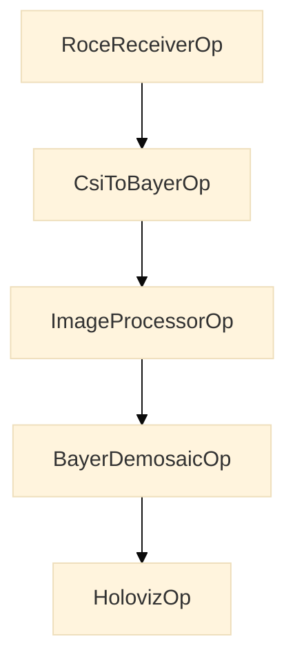

- `RoceReceiverOp` wakes up when an end-of-frame UDP message is received. When it
  finishes, the received frame data is available in GPU memory, along with metadata
  which is published to the application layer. Holoscan sensor bridge uses
  [RoCE v2](https://en.wikipedia.org/wiki/RDMA_over_Converged_Ethernet) to transmit data
  plane traffic over UDP; this is why the receiver is called `RoceReceiverOp`.
- `CsiToBayerOp` is aware that the received data is a CSI-2 RAW10 image, which it
  translates into a [Bayer video frame](https://en.wikipedia.org/wiki/Bayer_filter).
  Each pixel color component in this image is decoded and stored as a uint16 value. For
  more information about RAW10, see the
  [MIPI CSI-2 specification](https://www.mipi.org/specifications/csi-2).
- `ImageProcessorOp` adjusts the received Bayer image color and brightness to make it
  acceptable for display.
- `BayerDemosaicOp` converts the Bayer image data into RGBA.
- `HolovizOp` displays the RGBA image on the GUI.

For each step in the pipeline, the image data is stored in a buffer in GPU memory.
Pointers to that data are passed between each element in the pipeline, avoiding
expensive memory copies between host and GPU memory. GPU acceleration is used to perform
each operator's function, resulting in very low latency operation.

The Python `imx274_player.py` and C++ `imx274_player.cpp` files initialize the sensor
bridge device, camera, and pipeline in this way. To enhance readability, some details
are skipped--be sure and check the actual example code for more details. Both programs
use the Holoscan SDK 5 API.

<Tabs>

<Tab title="Python" language="python">

```python
  import holoscan as hs
  from cuda.bindings import driver as cuda_driver

  import hololink as hololink_module

  def main():
      # Get handles to GPU
      cuda_driver.cuInit(0)
      cu_device_ordinal = 0
      _, cu_device = cuda_driver.cuDeviceGet(cu_device_ordinal)
      _, cu_context = cuda_driver.cuDevicePrimaryCtxRetain(cu_device)

      # Look for sensor bridge enumeration messages; return only the one we're looking for
      channel_metadata = hololink_module.Enumerator.find_channel(channel_ip="192.168.0.2")
      # Use that enumeration data to instantiate a data receiver object
      hololink_channel = hololink_module.DataChannel(channel_metadata)

      # Connect and initialize the sensor bridge device
      hololink = hololink_channel.hololink()
      hololink.start()  # Establish a connection to the sensor bridge device
      hololink.reset()  # Drive the sensor bridge to a known state

      # Now that we can communicate, create the camera controller and configure the
      # camera for 4k at 60 frames per second (mode 0)
      camera = hololink_module.NativeImx274Sensor(hololink_channel, expander_configuration=0)
      camera.setup_clock()
      camera.configure(0)

      # Set up our Holoscan pipeline and compile it into an execution plan
      graph = hs.Graph("imx274_player")
      ...
      plan = hs.compile(graph, options)

      # Run our Holoscan pipeline until the window closes
      with hs.run_async(plan) as session:
          session.wait()
      hololink.stop()
```

</Tab>
<Tab title="C++" language="cpp">

```cpp
  #include <hololink/core/data_channel.hpp>
  #include <hololink/core/enumerator.hpp>
  #include <hololink/sensors/camera/imx274/native_imx274_sensor.hpp>

  #include "player_support.hpp" // helpers the example players share

  namespace hx = hololink::examples;

  int run_player(const PlayerOptions& options, holoscan::ManagedShutdownSignals& signals)
  {
      // Get handles to GPU
      const int cuda_device_ordinal = 0;
      CudaCheck(cuInit(0));
      CUdevice cu_device;
      CudaCheck(cuDeviceGet(&cu_device, cuda_device_ordinal));
      CUcontext cu_context;
      CudaCheck(cuDevicePrimaryCtxRetain(&cu_context, cu_device));

      // Look for sensor bridge enumeration messages; return only the one we're looking for
      auto channel_metadata = hololink::Enumerator::find_channel(options.hololink_ip);
      // Use that enumeration data to instantiate a data receiver object
      auto hololink_channel = std::make_shared<hololink::DataChannel>(channel_metadata);

      // Now that we can communicate, create the camera controller
      auto camera = std::make_shared<hololink::sensors::NativeImx274Sensor>(
          *hololink_channel, options.expander_configuration);
      camera->set_mode(options.camera_mode);

      // Set up our Holoscan pipeline and compile it into an execution plan
      holoscan::Graph graph { "imx274_player" };
      ...
      const auto plan = holoscan::compile(graph, std::move(compile_options));

      // Connect and initialize the sensor bridge device
      auto hololink_dev = hololink_channel->hololink();
      hololink_dev->start(); // Establish a connection to the sensor bridge device
      hololink_dev->reset(); // Drive the sensor bridge to a known state

      // Configure the camera (--camera-mode; 1080p at 60 frames per second by default)
      camera->setup_clock();
      camera->configure(options.camera_mode);

      // Run our Holoscan pipeline until --frame-limit frames, Ctrl+C or the window closes
      auto session = holoscan::run_async(plan, signals);
      session.wait();
      const bool failed = hx::report_session(session, plan);
      hololink_dev->stop();
      ...
  }

  int main(int argc, char** argv)
  {
      ...
      return hx::run_with_managed_signals([&](holoscan::ManagedShutdownSignals& signals) {
          return run_player(options, signals);
      });
  }
```

</Tab>
</Tabs>

Important details:

- `Enumerator.find_channel` blocks the caller until an enumeration message that matches
  the given criteria is found. If no matching device is found, this method will time out
  (default 10 seconds) and raise an exception. Holoscan sensor bridge enumeration
  messages are sent once per second.
- Holoscan sensor bridge devices transmit enumeration messages for each data plane
  controller, which currently correspond directly with each sensor bridge Ethernet
  interface. If both interfaces on a device are connected to a host, the host will
  receive a pair of distinct enumeration messages, one for each data port, from the same
  sensor bridge device.
- Enumeration messages are sent to the local broadcast address, and routers are not
  allowed to forward these local broadcast messages to other networks. You must have a
  local connection between the host and the sensor bridge device in order to enumerate
  it.
- `Enumerator.find_channel` returns a dictionary of name/value pairs containing
  identifying information about the data port being discovered, including MAC ID, IP
  address, versions of all the programmable components within the device, device serial
  number, and which specific instance this data port controller is within the device.
  While the IP address may change, the MAC ID, serial number, and data plane controller
  instance are constant. The host does not need to request any of the data included in
  this dictionary; its all broadcast by the sensor bridge device.
- `DataChannel` is the local controller for a data plane on the sensor bridge device. It
  contains the APIs for configuring the target addresses for packets transmitted on that
  data plane-- this is used by the receiver operator, described below.
- In this example, the `camera` object provides most of the APIs that the application
  layer would access. When the application configures the camera, the camera object
  knows how to work with the various sensor bridge controller objects to properly
  configure `DataChannel`.
- Usually there are multiple `DataChannel` instances on a single `Hololink` sensor
  bridge device, and many APIs on the `Hololink` device will affect all the
  `DataChannel` objects on that same device. In this example, calling `hololink.reset`
  will reset all the data channels on this device; and in the stereo IMX274
  configuration, calling `camera.setup_clock` sets the clock that is shared between both
  cameras. For this reason, it's important that the application is careful about calling
  `camera.setup_clock`--resetting the clock (e.g. on the second image sensor) while the
  first camera is running can lead to undefined states.
- In C++, `holoscan::compile()` turns the graph into an execution plan, after the
  program has bound the operators' tensor outputs to the GPU with
  `bind_tensor_output_device()`, and `holoscan::run_async()` runs the plan. `main()`
  runs the player inside `hx::run_with_managed_signals()`, one of the helpers the
  example players share (`examples/player_support.hpp`), so Ctrl+C stops the run
  cooperatively and the camera and the sensor bridge device are still stopped on the way
  out. `hx::report_session()` prints the run's diagnostics and returns true when the run
  failed.
- In Python, `imx274_player.py` does not catch Ctrl+C. Ctrl+C causes `session.wait()` to
  raise `KeyboardInterrupt`, and the program does not call `hololink.stop()`. Other
  Python examples, for example `fusa_coe_vb1940_player.py`, catch `KeyboardInterrupt`,
  call `session.request_stop()` and then wait for the run to end.

Both programs build their Holoscan graph directly, before they run it. The Python
program builds the graph after `camera.configure()`. The C++ program builds and compiles
the graph after `camera->set_mode()`, and calls `camera->configure()` after
`holoscan::compile()`. Both include this:

<Tabs>

<Tab title="Python" language="python">

```python
  # camera.configure() earlier selected our image dimensions and pixel format.
  # This call asks the camera for the resulting CSI-2 frame geometry.
  geometry = hololink_module.resolve_generic_geometry(camera)

  # The geometry gives the overall size of the received image data.
  frame_size = (
      geometry["start_byte"]
      + geometry["bytes_per_line"] * geometry["pixel_height"]
      + geometry["trailing_bytes"]
  )

  # Create a receiver operator that fills out our frame buffer.  The receiver
  # operator knows how to configure hololink_channel to send its data
  # to us and to provide an end-of-frame indication at the right time.
  # It calls the two callbacks to start and stop the camera.
  receiver = graph.op(
      hololink_module.operators.RoceReceiverOp,
      "receiver",
      data_channel=hololink_channel,
      frame_context=int(cu_context),
      frame_size=frame_size,
      device_start=camera.start,
      device_stop=camera.stop,
  )

  # Create the CSI to bayer converter for the same geometry.
  csi = graph.op(
      hololink_module.operators.CsiToBayerOp,
      "csi_to_bayer",
      cuda_device_ordinal=cu_device_ordinal,
      geometry=geometry,
      bayer_format=camera.get_bayer_format(),
  )
  ...
  # Use add_flow to connect the operators together.  Each frame travels on two
  # ports: its data ("tensor") and its capture metadata ("metadata").
  graph.add_flow(receiver.tensor, csi.in_tensor, queue_depth=4)
  graph.add_flow(receiver.metadata, csi.in_metadata, queue_depth=4)
  graph.add_flow(csi.tensor, image_processor.in_tensor, queue_depth=4)
  graph.add_flow(csi.metadata, image_processor.in_metadata, queue_depth=4)
  graph.add_flow(image_processor.tensor, demosaic.input, queue_depth=4)
  graph.add_flow(
      demosaic.output, viz.video, queue_policy=hs.QueuePolicy.DROP_OLDEST, queue_depth=1
  )
```

</Tab>
<Tab title="C++" language="cpp">

```cpp
  // camera->set_mode() earlier selected our image dimensions and pixel format.
  // This call asks the camera to report the resulting CSI-2 frame geometry.
  hololink::csi::CsiGeometry geometry;
  camera->configure_converter(geometry);

  // The geometry gives the overall size of the received image data.
  const size_t frame_size = geometry.start_byte + geometry.bytes_per_line * geometry.pixel_height
      + geometry.trailing_bytes;

  // Create a receiver operator that fills out our frame buffer.  The receiver
  // operator knows how to configure hololink_channel to send its data
  // to us and to provide an end-of-frame indication at the right time.
  // It calls the two callbacks to start and stop the camera.
  auto receiver = graph.op<hololink::operators::RoceReceiverOp>(
      "receiver",
      hololink_channel,
      [camera] { camera->start(); },
      [camera] { camera->stop(); });
  receiver.set_params(hololink::operators::RoceReceiverParams {
      .frame_context = cu_context,
      .frame_size = frame_size,
      .ibv_name = options.ibv_name,
      .ibv_port = options.ibv_port,
      .frame_limit = options.frame_limit,
  });

  // Create the CSI to bayer converter for the same geometry.
  const auto bayer_format = camera->get_bayer_format();
  auto csi = graph.op<hololink::operators::CsiToBayerOp>("csi_to_bayer");
  csi.set_params(hololink::operators::CsiToBayerParams {
      .cuda_device_ordinal = cuda_device_ordinal,
      .geometry = geometry,
      .bayer_format = bayer_format,
  });
  ...
  // Use add_flow to connect the operators together.  Each frame travels on two
  // ports: its data ("tensor") and its capture metadata ("metadata").
  graph.add_flow(receiver->tensor, csi->input_tensor, hx::pipeline_edge());
  graph.add_flow(receiver->metadata, csi->input_metadata, hx::pipeline_edge());
  graph.add_flow(csi->output_tensor, ip->input_tensor, hx::pipeline_edge());
  graph.add_flow(csi->output_metadata, ip->input_metadata, hx::pipeline_edge());
  graph.add_flow(ip->output_tensor, demosaic->input, hx::pipeline_edge());
  graph.add_flow(demosaic->output, viz->image_layer_input(0), hx::display_edge());
```

</Tab>
</Tabs>

Some key points:

- `receiver` has no idea it is dealing with video data. It's just informed of the memory
  region(s) to fill and the size of a block of data. When a complete block of data is
  received, the CPU will be notified so that pipeline processing can continue.
- Given an expected frame size, the receiver buffer will allocate GPU memory large
  enough for the received data plus additional metadata; that memory is allocated in a
  way that meets hardware and subsequent operator requirements.
- `CsiToBayerOp` is aware of memory layout for CSI-2 formatted image data. The camera
  reports its image dimensions and pixel depth as a CSI-2 frame geometry:
  `hololink_module.resolve_generic_geometry(camera)` in Python,
  `camera->configure_converter(geometry)` in C++. The program calculates the frame size
  from that geometry, and the same geometry goes into `CsiToBayerOp`. This memory size
  includes not only the image data itself, but CSI-2 metadata, and GPU memory alignment
  requirements. Because CsiToBayerOp is a GPU accelerated function, it may have special
  memory requirements that the camera sensor object is not aware of.
- In C++, `graph.op<>()` adds an operator to the graph and `set_params()` configures it,
  but `graph.op<>()` defers constructing the operator. So the camera reports its
  geometry into a `hololink::csi::CsiGeometry` instead of configuring a live
  `CsiToBayerOp`, the program computes the frame size from that geometry, and the same
  geometry goes into `CsiToBayerParams`.
- `receiver` coordinates with `hololink_channel` to configure the sensor bridge data
  plane. Configuration automatically handles setting the sensor bridge device with our
  host Ethernet and IP addresses, destination memory addresses, security keys, and frame
  size information.
- the sensor bridge device, following configuration by the `hololink_channel` object,
  will start forwarding all received sensor data to the configured receiver. We haven't
  instructed the camera to start streaming data yet, but at this point, we're ready to
  receive it.
- The receiver operator gets two callbacks that start and stop the device. In Python,
  the program passes `device_start=camera.start` and `device_stop=camera.stop`. In C++,
  the receiver's constructor takes the callbacks; `imx274_player.cpp` passes lambdas
  that call `camera->start()` and `camera->stop()`. When the run calls the `start`
  method of the receiver, the receiver calls the start callback. In the IMX274 player,
  this callback tells the camera to start to send data. With `--frame-limit`, the
  receiver stops after that many frames (`frame_limit`), and the run then completes by
  itself.
- In C++ and in Python, each link carries a frame on two ports: `tensor`, the frame's
  data, and `metadata`, its `hololink::CaptureMetadataT` (see `MIGRATION.md`). Only the
  image goes on to `BayerDemosaicOp`, so `ImageProcessorOp`'s `metadata` output stays
  unconnected. In C++, `hx::pipeline_edge()` gives each link of the chain a two-frame
  queue. `hx::display_edge()` gives the link into `HolovizOp` a one-frame queue that
  drops the oldest frame. When `HolovizOp` runs on its own thread and the display is
  slow, the display shows the newest frame. The pipeline does not wait for the display.
  In Python, `imx274_player.py` gives each link of the chain a four-frame queue
  (`queue_depth=4`). It gives the link into `HolovizOp` a one-frame queue that drops the
  oldest frame (`hs.QueuePolicy.DROP_OLDEST`).

In this example, `receiver` is a `RoceReceiverOp` instance, which takes advantage of the
RDMA acceleration features present in the ConnectX firmware. It uses the ConnectX device
on the network interface that the sensor bridge device enumerated on, unless `ibv_name`
(the player's `--ibv-name`) names another one. With `RoceReceiverOp`, the CPU only sees
an interrupt when the last packet for the frame is received--all frame data sent before
that is written to GPU memory in the background. In systems without ConnectX devices,
`LinuxReceiverOp` (as in `linux_imx274_player.py` and `linux_imx274_player.cpp`)
provides the same functionality but uses the host CPU and Linux kernel to receive the
ingress UDP requests; and the CPU writes that payload data to GPU memory. This provides
the same functionality as `RoceReceiverOp` but at considerably lower performance.

## linux_tsn_imx274_player

`examples/linux_tsn_imx274_player.py` adds Time-Sensitive Networking (TSN) support on
top of the standard Linux IMX274 player. Before the Holoscan pipeline starts, it
programs the FPGA with a PTP profile and domain, and enables 802.1Q VLAN tagging on the
sensor virtual port and the EVT channel. The video pipeline itself is identical to the
Linux IMX274 player.

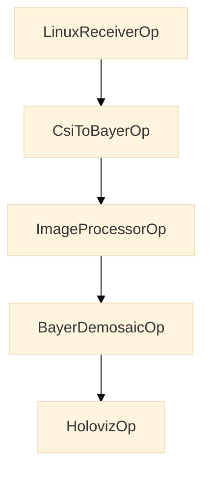

### TSN configuration sequence

VLAN parameters are stamped into the channel metadata before the `DataChannel` is
constructed, using `use_vlan()`. PTP is programmed directly on the `Hololink` object
after `reset()`. VLAN tagging is then applied automatically when the receiver calls
`configure_roce()` or `configure_coe()`.

```python
# Before constructing the DataChannel:
hololink_module.use_vlan(
    channel_metadata,
    vlan_id=args.vlan_id,
    sensor_pcp=args.sensor_pcp,
    evt_pcp=args.evt_pcp,
)
hololink_channel = hololink_module.DataChannel(channel_metadata)

# After hololink.reset():
hololink.configure_ptp(args.ptp_profile, args.ptp_domain)
# VLAN tagging is applied automatically when the receiver configures the channel.
```

`use_vlan()` validates that `vlan_id` is in `[1, 4094]` and raises `ValueError`
otherwise. In Python, `use_vlan()` is a module function (`hololink.use_vlan()`). In C++,
it is the static method `DataChannel::use_vlan()`. The VLAN configuration covers two
targets:

- **Sensor VP** — tags sensor data traffic from the virtual port with the given VLAN ID
  and `sensor_pcp`.
- **EVT** — tags FPGA event notification traffic with the same VLAN ID and `evt_pcp`.

### PTP API

Three convenience methods are available on the `Hololink` object for PTP configuration:

| Method                           | Profile written           | Use when                                      |
| -------------------------------- | ------------------------- | --------------------------------------------- |
| `configure_ptp(profile, domain)` | caller-supplied           | any profile, or switching profiles at runtime |
| `configure_gptp(domain)`         | `1` (gPTP / IEEE 802.1AS) | running `gptp4l` on the host                  |
| `configure_1588(domain)`         | `0` (IEEE 1588 E2E)       | running `ptp4l` on the host                   |

`configure_gptp` and `configure_1588` are thin wrappers around `configure_ptp`. They are
available in C++ only. In Python, use `configure_ptp(profile, domain)`.

### Host-side VLAN requirement

VLAN-tagged packets from the HSB arrive on the VLAN subinterface (e.g.
`<iface>.<vlan-id>`). Create the subinterface and assign the host's IP address to it:

```sh
sudo ip link add link <iface> name <iface>.<vlan-id> type vlan id <vlan-id>
sudo ip link set <iface>.<vlan-id> up
sudo ip addr add 192.168.0.101/32 dev <iface>.<vlan-id>
```

Without the subinterface, the kernel's VLAN demux delivers packets to the subinterface
but the socket on the parent interface does not see them.

## tao_peoplenet

A demonstration application where inference is used to generate a video overlay is
included in examples/tao_peoplenet.py. The
[Tao PeopleNet](https://docs.nvidia.com/tao/archive/5.3.0/text/model_zoo/cv_models/peoplenet.html)
is used to determine the locations of persons, bags, and faces in the live video stream.
This example program draws bounding boxes on an overlay illustrating where those objects
are detected in the video frame.

Pipeline structure:

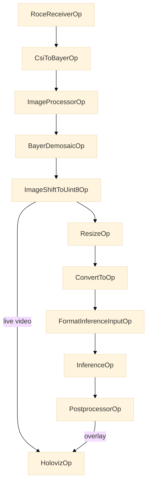

Adding inference to the video pipeline is easy: just add the appropriate operators and
data flows. In our case, we use the video mixer built in to `HolovizOp` to display the
overlay generated by inference. The Holoscan SDK 5 `ResizeOp` and `ConvertToOp`
(`holoscan_vision`) prepare the image for inference. They replace the
`FormatConverterOp` of earlier releases. In `tao_peoplenet.py`, each link uses a queue
that drops the oldest frame when the queue is full (`hs.QueuePolicy.DROP_OLDEST`). If
the inference takes more than one frame time, the pipeline drops the older frames. The
receiver does not wait.

## body_pose_estimation

The Body Pose Estimation application takes input from a live video, performs inference
using YOLOv8 pose model, and then shows keypoints overlaid onto the original video. The
keypoints are:

\[nose, left eye, right eye, left ear, right ear, left shoulder, right shoulder, left
elbow, right elbow, left wrist, right wrist, left hip, right hip, left knee, right knee,
left ankle, right ankle\]

This application's pipeline is the same as the People Detection application:


The difference is that InferenceOp uses the YOLOv8 pose model and the post processor
operator has logic that performs postprocessing specific to the YOLOv8 model.
Specifically, it takes the output of Inference and filters out detections that have low
scores and applies non-max suppression (nms) before sending the output to `HolovizOp`.

## IMX274 Stereo live video demonstration

Multiple receiver operators can be instantiated to support data feeds from multiple
cameras. In `examples/stereo_imx274_player.py`, the same pipeline for live video feed is
presented, except that it is instantiated twice, once for each camera on the IMX274
stereo camera board. Both pipelines go into one `HolovizOp`, which shows the two images
side by side in one window. Each receiver instance (`rx` in the example) is independent
and runs simultaneously.

For systems with only a single network connection, Holoscan Sensor Bridge can be
configured to transmit both cameras' data over the same network connection. The 10Gbps
network port on HSB doesn't have the bandwidth to support two 4K 60FPS video streams, so
support is limited to cameras in 1080p mode. See
`examples/single_network_stereo_imx274_player.py` for an example showing how to
configure HSB to work in this way. As before, each receiver (`rx`) is independent, even
when using the same network interface.

## GPIO Example application

This application demonstrates how to utilize the hololink GPIO interface and can be
found in `examples/gpio_example_app.py`.

The hololink GPIO interface supports 16 GPIOs numbered 0..15. These GPIOs can be set as
either **input** or **output** and have 2 logical values:

- **High** - 3.3V can be measured on the GPIO pin
- **Low** - 0V can b measured on the GPIO pin

The following image maps the GPIO and ground pins on the hololink board:

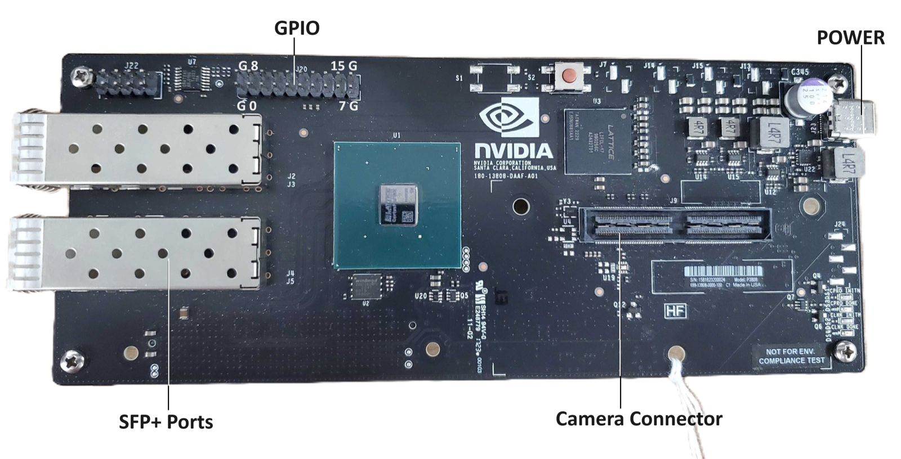

As can be observed from the image:

- The 4 pins in the corners of the connector are ground pins (marked 'G' in the image
  above)
- The lower set of pins between the 2 lower ground pins are GPIO pins numbered 0 to 7
- The upper set of pins between the 2 upper ground pins are GPIO pins numbered 8 to 15

### GPIO Example application flow

The GPIO Example is a simple application made up of 2 operators as can be seen in the
following diagram:

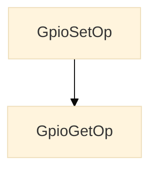

- **GPIO Set Operator** - this operator sweeps through the 16 GPIO pins setting them one
  by one to values and directions defined per 5 different pin configurations:

1. **ALL_OUT_L**- All pins output low
1. **ALL_OUT_H**- All pins output high
1. **ALL_IN** - All pins input
1. **ODD_OUT_H**- Odd pins output high, even pins input
1. **EVEN_OUT_H** -Even pins output high, odd pins input

Each cycle of this operator configures one pin to a direction and value and sends the
last changed pin number and the current running configuration to the GPIO get operator.
The operator runs one cycle every `--sleep-time` seconds (default 2), on an `hs.OnClock`
trigger. With `--cycle-limit`, the operator stops the run after that many cycles.\
Once all 16 pins are set per the currently running configuration,the operator will move
on the next cycle to the next configuration.

- **GPIO Get Operator** (`GpioGetOp`) - This operator reads and displays the current
  direction and value of the last configured pin. The `--sleep-time` interval of the
  GPIO set operator gives you time to measure the pin level and direction. Use an
  external instrument, for example a multimeter or an oscilloscope.

### GPIO Software interface

The GPIO interface is a class defined within the hololink module. It exports the
following GPIO interface:

1. **get_gpio( metadata )** - gets a GPIO interface instance from the sensor bridge
   device object (`hololink.get_gpio(metadata)` in Python)
1. **set_direction( pin, direction )** - sets the pin direction as input or output
1. **get_direction( pin )** - gets the direction set for the pin
1. **set_value( pin, value )** - for pins set as direction **output**, set the value of
   the pin to high or low.
1. **get_value( pin )** - for pins set as direction **input**, reads the value of the
   pin (high or low).

- **pin numbers** - range between 0 to 15.
- **pin direction** - enumerated values: IN-1,OUT-0
- **pin values** - enumerated values: HIGH-1,LOW-0

## NVIDIA ISP for live capture

Jetson boards have built in support for ISP (Image Signal Processing) unit for
processing Bayer images and outputting images in standard color space(s). The ISP is
operational on Jetson AGX Orin.

A sample ISP application presented in `examples/linux_hwisp_player.py` configures the
following pipeline. Each operator runs when a new frame arrives at its input.

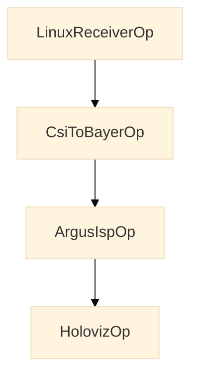

`ArgusIspOp` allows the users to access the ISP via Argus API. This operator takes in
Bayer uncompressed image of uint16 per pixel (MSB aligned) and outputs RGB888 image. It
is a C++ operator. Python applications use it as `hololink.operators.ArgusIspOp`.
`ArgusIspOp` is in the build only when `HOLOLINK_BUILD_ARGUS_ISP` is `ON`. A CMake build
sets it to `OFF` by default. The Python package build sets it to `ON` on L4T R39 or
newer hosts that have the Jetson Multimedia API in
`/usr/src/jetson_multimedia_api/argus`.

The `ArgusIspOp` can be configured using the following parameters at the application
level. Below is a snippet from an existing Python-based example.

<Tabs>

<Tab title="Python" language="python">

```python
  argus_isp = graph.op(
      hololink_module.operators.ArgusIspOp,
      "argus_isp",
      bayer_format=bayer_format,  # RGGB or other Bayer format
      exposure_time_ms=16.67,  # Exposure time in milliseconds. 60fps is 16.67ms
      analog_gain=10.0,  # Minimum Analog Gain
      pixel_bit_depth=10,  # Effective bit depth of input per pixel
      sensor_mode_index=camera_mode,
  )
```

</Tab>
</Tabs>

The input to the `ArgusIspOp` is a Bayer Image uncompressed to uint16 per pixel. The
values in uint16 should be MSB aligned. For example, if the camera sensor produces
Raw10, the 10bits should be MSB aligned in 16bits. Currently supported output from
`ArgusIspOp` is RGB888 in Rec 709 standard color space and gamma corrected.

The glass to display latency of the pipeline mentioned above on Jetson AGX Orin is 37ms
for a resolution of 1920x1080 at 60 fps.

Please reach out to NVIDIA for further questions on ISP capabilities and usage.

## ECam0M30ToF Player

**Note:** **This example isn't supported on Holoscan SDK 5 yet**; it will be supported
in an upcoming update to release 3.0.

The `ecam0m30tof_player.py` application demonstrates the use of the ECam0M30ToF
time-of-flight camera and showcases handling of depth and IR data in the pipeline. This
application uses RoCE for high-performance data transmission and supports multiple
camera modes for different use cases.

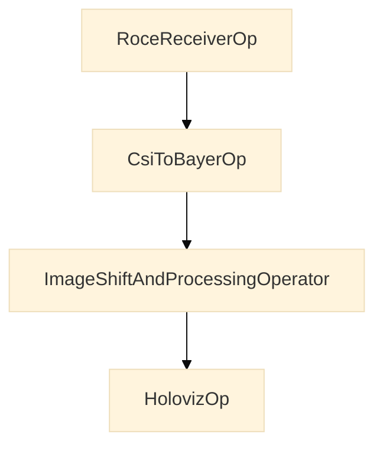

The `ImageShiftAndProcessingOperator` is a new operator designed to process depth and IR
data. It performs the following operations:

- Converts depth data to grayscale for visualization
- Handles dual-plane data (depth + IR) when in combined mode
- Performs data format conversion and normalization

The `HolovizOp` provides rendering for both Active IR and depth data. The depth data is
shown in grayscale: earlier releases rendered it with the `HolovizOp` `DEPTH_MAP`
option, which the Holoscan SDK 5.0 `HolovizOp` does not have.

## Audio Player

The Hololink board includes an I2S (Inter‑IC Sound) audio peripheral that provides a
digital audio link between the FPGA and external audio devices such as DACs, codecs, or
amplifiers. It uses a 32‑bit AXI‑Stream interface on the FPGA side for audio samples and
an APB register interface for configuration and status.

On the board pins, the peripheral drives the standard I2S signals: a bit clock (BCLK), a
word‑select / left‑right clock (LRCLK), a master clock (MCLK), and serial data (SDATA).
Internally, configurable clock dividers derive MCLK, BCLK, and LRCLK from a reference
clock to generate the desired audio sample rate.

Two example applications are provided:

- `linux_audio_player.py` – streams audio to the Hololink board using **UDP / Linux
  sockets**.
- `audio_player.py` – streams audio using **RoCE / RDMA**.

Both use the same FPGA I2S path and require the same WAV file format described below.

### UDP / Linux socket path (`linux_audio_player.py`)

The `linux_audio_player.py` application demonstrates how to stream audio samples from a
WAV file on the host to a Hololink board and play them out through the I2S interface
using a UDP-based transport path.

The application builds a simple Holoscan pipeline that packetizes audio samples and
sends them to the Hololink device over UDP:

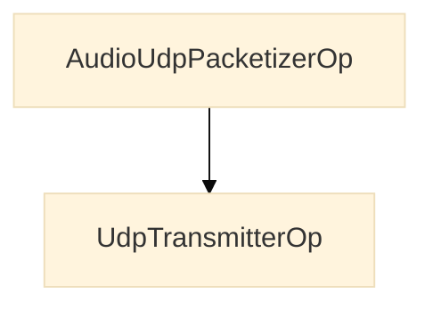

- `AudioUdpPacketizerOp` reads audio data from a WAV file on the host, splits it into
  fixed-size chunks (controlled by `chunk_size`), and publishes those chunks into the
  Holoscan pipeline using a UDP-oriented packet format (IB-style header + CRC). It is a
  Python operator in `linux_audio_player.py`. An `hs.OnClock` trigger paces it at the
  playback rate of the WAV file. The C++ `AudioPacketizerOp` of earlier releases is not
  ported to Holoscan SDK 5. The default build does not include it
  (`HOLOLINK_BUILD_UNPORTED_OPERATORS` is `OFF`).
- `UdpTransmitterOp` sends each audio chunk as UDP packets to the Hololink device at the
  configured IP address and port. `linux_audio_player.py` sets the port to 4791; the
  operator's default port is 5000.

Before starting the Holoscan application, `linux_audio_player.py` configures the
Hololink device to enable I2S transmit by writing to a set of device registers (function
`en_i2s_tx`, which calls `enable_i2s`, `set_tx_af_ae`, and `set_tx_pause`). This sets up
the transmit FIFO thresholds and pause behavior so that the incoming UDP audio stream is
played out on the I2S interface.

You can run the application from the `examples` directory with:

```bash
python3 linux_audio_player.py \
  --hololink <HOLINK_IP_ADDRESS> \
  --wav-file </path/to/file.wav> \
  [--chunk-size 192]
```

### RoCE path (`audio_player.py`)

The `audio_player.py` application is a RoCE-based variant of the audio player that uses
`RoceTransmitterOp` instead of `UdpTransmitterOp`. It streams the same WAV audio format
over a RoCE link, relying on the RDMA stack for framing and reliability.

The Holoscan pipeline is:

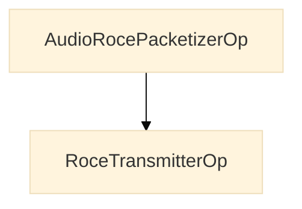

- `AudioRocePacketizerOp` reads the WAV file and produces fixed-size audio payloads
  (with no IB header or CRC in this configuration). It is a Python operator in
  `audio_player.py`.
- `RoceTransmitterOp` sends each payload buffer over the configured RoCE connection to
  the Hololink board, which then forwards the samples into the same I2S playback path as
  in the UDP-based example.

Before starting the Holoscan application, `audio_player.py` configures the I2S transmit
path with `hololink.get_i2s(metadata)`.

From the `examples` directory, you can run:

```bash
python3 audio_player.py \
  --hololink <HOLINK_IP_ADDRESS> \
  --wav-file </path/to/file.wav> \
  [--chunk-size 192] \
  [--ibv-name <IB_DEVICE>] \
  [--ibv-port <PORT>] \
  [--ibv-qp <QP_NUM>] \
  [--queue-size <N>]
```

**NOTE**: The current I2S/FPGA audio path and application are designed for a fixed audio
format. The WAV file must use the following audio parameters:

- **Channels**: Stereo
- **Sample rate**: 48 kHz
- **Sample size**: 24-bit
- **Bit rate**: 2304 kbps

## Sub-Frame Processing Applications

Sub-frame processing is a feature that allows high-resolution sensor data frames to be
processed incrementally as they arrive, rather than waiting for the complete frame to be
received. This enables reduced memory requirements for processing large frames by using
smaller sub-frame buffers.

### What is Sub-Frame Processing?

In traditional frame-based processing, a complete frame must be received before any
processing or display can occur. For high-resolution sensors (e.g., 4K cameras at 60fps,
high-density lidar point clouds, or radar data), this can introduce significant latency,
as the entire frame must be buffered before processing begins.

Sub-frame processing divides each frame into multiple horizontal strips (sub-frames)
that are processed independently as they arrive. Each sub-frame contains a contiguous
set of rows from the original frame. For example, a 2160-row tall image frame can be
divided into sub-frames of 540 rows each, resulting in 4 sub-frames per complete frame.
The same concept can be applied to other sensor data types that can be divided into
horizontal strips.

### Sub-Frame Processing Pipeline

There are two display modes for sub-frame processing, depending on whether
display-synchronized capture is required:

**Sub-Frame Combiner Mode** (e.g., the C++ and Python IMX274 examples): Sub-frames are
accumulated into a complete frame, which is then demosaiced and displayed. Capture
timing is independent of the display.

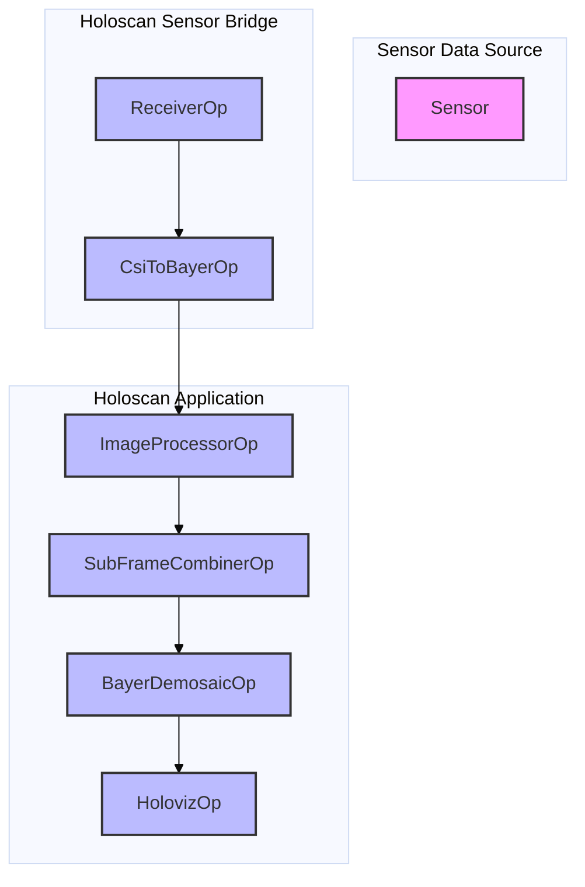

**Sub-Frame Visualizer Mode** (e.g., VB1940 example): Sub-frames are composited directly
to the display as they arrive. Capture is synchronized to the display refresh via FPGA
PTP/PPS, minimizing end-to-end latency.

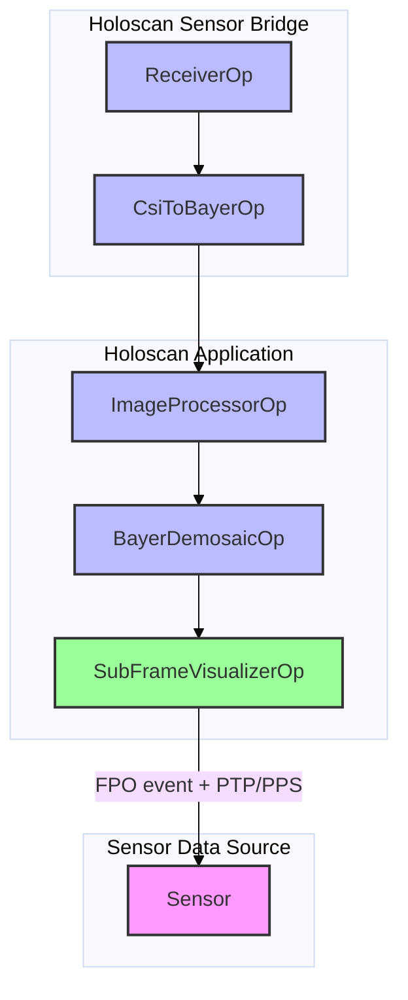

### Operator-Specific Sub-Frame Behavior

#### CsiToBayerOp

When `sub_frame_rows` parameter is set to a non-zero value:

- **Sub-frame accumulation**: Incoming packets are accumulated into sub-frame-sized
  buffers
- **Metadata handling**: The first sub-frame packet may contain a header (`start_byte_`)
  that is skipped
- **Sub-frame emission**: A sub-frame is emitted once the receiver chunk that completes
  it has arrived. A sub-frame that lost data upstream (a dropped, short or holed chunk)
  is still emitted, its lost rows holding stale data, and flagged
  `holoscan::SampleFlags::kDegraded`; set `drop_incomplete` to withhold it instead
- **Offset calculation**: Converts byte-based offsets to line-based offsets for
  downstream operators
- **Frame numbering**: Converts receiver frame numbers to full frame numbers based on
  sub-frames per frame

#### ImageProcessorOp

Sub-frame processing affects white balance calculation:

- **Histogram accumulation**: Histograms are accumulated across all sub-frames of a
  frame
- **White balance timing**: White balance gains are calculated when a new frame starts
  (detected by frame number change)
- **Gain application**: White balance gains from the previous frame are applied to
  current sub-frames
- **Per-sub-frame processing**: Optical black correction and histogram generation are
  performed independently on each sub-frame
- **Out-of-order handling**: A sub-frame whose frame number differs from the frame being
  accumulated, including a late one from an earlier frame, ends that frame: its gains
  are calculated and a new histogram starts

#### SubFrameCombinerOp

Combines sub-frames into complete frames:

- **Frame tracking**: Tracks expected frame numbers to detect dropped sub-frames
- **Row accumulation**: Accumulates rows from sub-frames into a complete frame buffer
- **Emission**: Emits a frame once its last row has arrived, or once the next frame
  starts if its last rows never arrive. A frame missing a sub-frame, or holding one
  flagged degraded, is flagged `holoscan::SampleFlags::kDegraded`, its missing rows
  holding an earlier frame's content; set `drop_incomplete` to discard such frames
  instead
- **Error handling**: Warns if sub-frames are dropped or arrive out of order

#### SubFrameVisualizerOp

Accumulates and visualizes sub-frames with display-synchronized camera capture. Unlike
`SubFrameCombinerOp`, sub-frames are composited directly to the display as they arrive.
The operator does not wait for a complete frame before rendering.

A dedicated background thread listens for the display **First Pixel Out (FPO)** event,
which fires once per display refresh at the start of each vertical blanking interval. On
each FPO event the thread computes the optimal FPGA camera trigger time for the next
capture by measuring the pipeline delay (time from FPGA trigger to first sub-frame
arriving in `compute()`), then schedules the next capture so that the captured frame
completes rendering just before the following vblank.

This synchronization uses the FPGA **PTP/PPS single-pulse** output: one `set_delay()`
call per FPO event advances the capture phase by one display period, producing a
continuous 60 Hz trigger cadence that is phase-locked to the display refresh.

Key behaviors:

- **Pipelined capture**: Frame N+1 is captured while frame N is being rendered, keeping
  the capture rate equal to the display refresh rate.
- **Cached pipeline delay**: If a frame is still in-flight when the FPO fires, the last
  measured pipeline delay is reused to avoid destabilizing the FPGA trigger phase.
- **Slow-camera detection**: If `render_start_time` is unchanged between consecutive FPO
  events, a warning is logged indicating that the camera rate is below the display rate.
  Capture scheduling continues regardless.
- **Missing FPO events**: If the wait for an FPO event times out or fails, the thread
  waits again and makes no `set_delay()` call until an event arrives. If the GPU does
  not support display events, or the operator cannot find the display behind its window,
  the operator logs a warning and stops scheduling captures. Rendering in `compute()`
  does not depend on FPO events.

Constructor arguments, in order:

- **`full_frame_height`**: Total frame height in rows. Required for correct sub-frame
  compositing.
- **`fullscreen`**: Run in fullscreen mode. Default: `false`.
- **`use_exclusive_display`**: Use exclusive display mode (lower latency, requires
  display ownership). Default: `false`.
- **`display_name`**: Display name for exclusive display mode. Default: `""`.
- **`display_width`**: Display width in pixels. Default: `1920`.
- **`display_height`**: Display height in pixels. Default: `1080`.
- **`display_framerate`**: Display framerate in Hz×1000 (e.g., `60000` for 60 Hz).
  Default: `59950`.
- **`window_title`**: Window title for windowed mode. Default: `"Sub-Frame Visualizer"`.
- **`ptp_synchronizer`**: The `std::shared_ptr<Hololink::PtpSynchronizer>` from
  `ptp_pps_output(1)`. Required for display sync; if `nullptr`, capture runs
  unsynchronized. Default: `nullptr`.
- **`present_mode`**: The `holoviz::PresentMode` to present with. Default: `kFIFO`.

### Configuration

Sub-frame processing is enabled by setting the `sub_frame_rows` parameter in
`CsiToBayerOp`:

- **`sub_frame_rows = 0`**: Disables sub-frame processing (default, full-frame mode)
- **`sub_frame_rows > 0`**: Enables sub-frame processing with the specified number of
  rows per sub-frame

**Important constraints:** `sub_frame_rows` must evenly divide the frame height. It must
also be even when the sub-frames are processed as Bayer images (by `ImageProcessorOp`,
or by a demosaic per sub-frame as in the VB1940 example): these take the color filter
phase from each sub-frame's first row, so every sub-frame must start on an even image
row. The example applications reject an odd value.

The sub-frame size should be chosen based on:

- **Network packet size**: Should align with expected packet sizes to minimize partial
  sub-frames
- **Memory constraints**: Smaller sub-frames use less memory per buffer, but require
  more buffers to process a complete frame
- **Display refresh rate**: Sub-frame size affects how smoothly data appears on display
- **Latency requirements**: Smaller sub-frames can reduce end-to-end latency by enabling
  earlier processing start, but this benefit must be balanced against increased
  processing overhead from handling more sub-frames per frame
- **Sensor data characteristics**: Different sensor types may benefit from different
  sub-frame sizes based on their data structure and processing requirements

### Limitations and Considerations

- **Out-of-order arrival**: Sub-frames may arrive out of order due to network
  conditions. Operators handle this by tracking frame numbers and sub-frame offsets.

- **Dropped sub-frames**: If sub-frames are dropped or lose data upstream, the frame is
  incomplete. By default it is still passed on, flagged
  `holoscan::SampleFlags::kDegraded` (the lost rows hold stale data), and
  `SubFrameCombinerOp` warns about the dropped sub-frames. Set `drop_incomplete` in
  `CsiToBayerParams` and `SubFrameCombinerParams` to withhold such sub-frames and
  discard such frames instead.

- **White balance accuracy**: White balance gains are calculated from the previous
  frame's histogram, which may not perfectly match the current frame's lighting
  conditions.

### Example: Sub-Frame IMX274 Player

The sub-frame IMX274 player example (`sub_frame_imx274_player.py` or
`sub_frame_imx274_player.cpp`) demonstrates the complete sub-frame processing pipeline
without display synchronization:

1. **Receiver**: Receives network packets containing partial frame data
1. **CSI to Bayer**: Accumulates packets into sub-frames and converts to Bayer format
1. **Image Processor**: Processes sub-frames and accumulates histograms for white
   balance
1. **Sub-Frame Combiner**: Combines sub-frames into complete frames
1. **Demosaic**: Converts each complete frame to RGBA for display

Combining before demosaicing, rather than demosaicing each sub-frame as earlier versions
of this example did, leaves no seams at the sub-frame boundaries.

### Example: Sub-Frame VB1940 Player

The sub-frame VB1940 player example (`sub_frame_vb1940_player.cpp`) demonstrates
display-synchronized sub-frame capture and visualization using `SubFrameVisualizerOp`:

1. **Receiver**: Receives network packets from the VB1940 camera via ConnectX RoCE
1. **CSI to Bayer**: Accumulates packets into sub-frames and converts to Bayer format
1. **Image Processor**: Applies optical black correction and white balance
1. **Demosaic**: Converts Bayer sub-frames to RGBA
1. **Sub-Frame Visualizer**: Composites sub-frames onto the display as they arrive,
   while the FPO thread schedules the next FPGA camera capture synchronized to the
   display refresh

The `SubFrameVisualizerOp` uses `ptp_pps_output(1)` (single-pulse PPS mode) to trigger
the FPGA camera. One `set_delay()` call is issued per FPO event, advancing the capture
phase by one display period each tick. This produces a 60 Hz capture cadence that is
phase-locked to the display, achieving minimum pipeline latency.

See the [Sub-Frame Processing Examples](examples.mdx#sub-frame-processing-examples)
section for instructions on running sub-frame examples.
