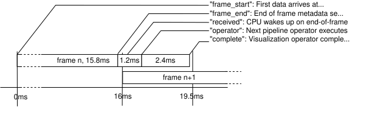

### HSB frame metadata

HSB devices send a block of metadata following each received data frame. That metadata
includes:

- `frame_number` counts of the number of data frames from this sensor sent by the FPGA
- `timestamp_s` and `timestamp_ns` are the PTP timestamp when the first data for the
  current frame arrived at the FPGA.
- `metadata_s` and `metadata_ns` are the PTP timestamp recorded when the metadata packet
  is sent out-- which exactly follows the last byte in the received data frame.

When host PTP support is properly configured, this time is synchronized with the host
time to within one microsecond. Receiver operators publish this metadata, together with
fields of their own, as a `hololink::CaptureMetadataT` sample on their `metadata` output
port, next to the frame on their `tensor` port. `MIGRATION.md` in the repository lists
the fields and shows how an operator receives a frame together with its metadata. Notes:

- Timestamps are comparable to the clock values read from the
  `clock_gettime(CLOCK_REALTIME, &timespec)` API.
- Receiver operators fill different sets of fields based on the unique characteristics
  of that implementation. For example, `frame_bytes_received` comes from
  `LinuxReceiverOp` (native and `hololink_module`) and `LinuxCoeReceiverOp` but not from
  the RoCE receivers, and `psn` from the same Linux receivers and the `hololink_module`
  `RoceReceiverOp` but not the native one. A field that the receiver doesn't fill is 0;
  `MIGRATION.md` lists which receivers fill each field.

### Measuring sensor data latency

The C++ examples `roce_imx274_latency` (RoCE receiver) and `linux_imx274_latency` (Linux
socket receiver) run the IMX274 player pipeline (the receiver, `CsiToBayerOp`,
`ImageProcessorOp`, `BayerDemosaicOp` and `HolovizOp`) and issue a latency report from
the metadata timestamps and two more:

- `operator` is recorded by the operator following the network receiver operator:
  `CsiToBayerOp` stores the time it starts on the frame in the `operator_entry_ns`
  metadata field. This is the time at which pipeline operators can actually access
  received sensor data.
- `complete` is recorded when the demosaiced image handed to `HolovizOp` is ready on the
  GPU. In Holoscan SDK 5, `HolovizOp` reports nothing after it renders into a window, so
  unlike the earlier Python version of this tool, this time does not include rendering.

The receiver operator also records `received_s` and `received_ns` which are recorded at
the time the CPU wakes up with the end-of-frame interrupt. This occurs in a background
thread, independent of the pipeline. The times listed below are computed by combining
`(name)_s` and `(name)_ns` into a single floating point seconds value. Time values
displayed are all typical but will vary.



The figure shows the earlier Python tool, which recorded `complete` after the
visualization operator finished rendering. This release did not measure the values in
the figure again.

- `frame_end - frame_start` is the time that the sensor requires to transfer an entire
  frame of data into the FPGA. For the IMX274 in 4k RAW10 mode, this is typically
  15.8ms.
- `received - frame_end` shows how long it takes for the CPU to wake up in the
  background thread due to end-of-frame indication. On an IGX with accelerated
  networking, this is typically 120us.
- `operator - received` is the time that it takes for the next pipeline operator to
  execute with the currently received data. On IGX, if the pipeline is idle, this time
  is typically around 1ms.
- `complete - operator` is the time required for the rest of the pipeline to prepare the
  frame for the display, from the moment `CsiToBayerOp` starts on the frame until its
  demosaiced image is ready on the GPU. It includes `CsiToBayerOp`'s CSI to Bayer
  conversion, the naive example ISP (`ImageProcessorOp`) and the demosaic
  (`BayerDemosaicOp`), with their GPU work and any of the receiver's copy of the frame
  that the GPU is still running. It also includes the time the frame waits as it passes
  between threads: `BayerDemosaicOp` and the operator that records `complete` run on a
  thread of their own, separate from `ImageProcessorOp`'s. If that thread falls behind,
  `ImageProcessorOp` drops frames rather than making the run fail. Rendering is not
  included.

The sample application therefore shows, for each video frame, almost 16ms of data
acquisition time followed by the processing time up to the display hand-off. In this
application, frames are delivered at 60FPS, which means that each new frame starts at a
16ms interval; reception of the next frame goes on in the background while the current
frame processing is underway.

### Running the latency tools

The tools are built with the C++ examples (see
[IMX274 player example](examples.mdx#imx274-player-example)). With PTP configured, run
the RoCE version on a ConnectX-accelerated host:

```sh
$ $BUILD_DIR/examples/roce_imx274_latency
```

or the Linux socket version on unaccelerated hosts:

```sh
$ $BUILD_DIR/examples/linux_imx274_latency
```

Each tool waits for the HSB's PTP synchronization, runs for `--frame-limit` frames (200
by default; 0 runs until Ctrl+C or the window closes), and then logs a report with the
minimum, maximum and average of each metric over the settled frames: all but the first
and last five. It needs at least 100 settled frames and fails otherwise. The report
lists `Frame Time` (`frame_end - frame_start`), `Frame Transfer Latency`
(`received - frame_end`), `Operator Latency` (`operator - received`),
`Processing Latency` (`complete - operator`) and `SW Pipeline Latency`
(`complete - frame_start`); the last two are labeled as ending at the display hand-off.
Run with `--log-level debug` to also log each frame's timestamps, and with `--help` for
the other options, such as `--camera-mode`, `--headless`, `--hololink`, and `--ibv-name`
and `--ibv-port` for the RoCE tool.

Python versions of these tools are also available: `examples/imx274_latency.py` (RoCE
receiver) and `examples/linux_imx274_latency.py` (Linux socket receiver). They use the
Holoscan SDK 5 Python API. Their measurement point is different. A sink operator after
`ImageProcessorOp` records `complete`. The optional display branch (`BayerDemosaicOp`
and `HolovizOp`) does not slow down the measurement. The Python tools run for
`--frame-limit` frames (300 by default) and log progress every `--log-interval` frames.
Use `--headless` to measure without the display branch. Run them with `--help` for the
other options.
