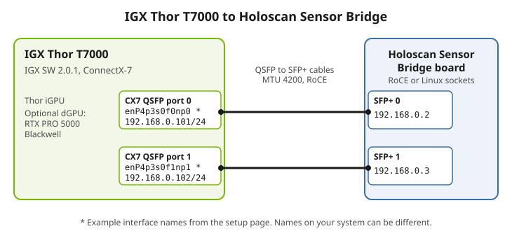
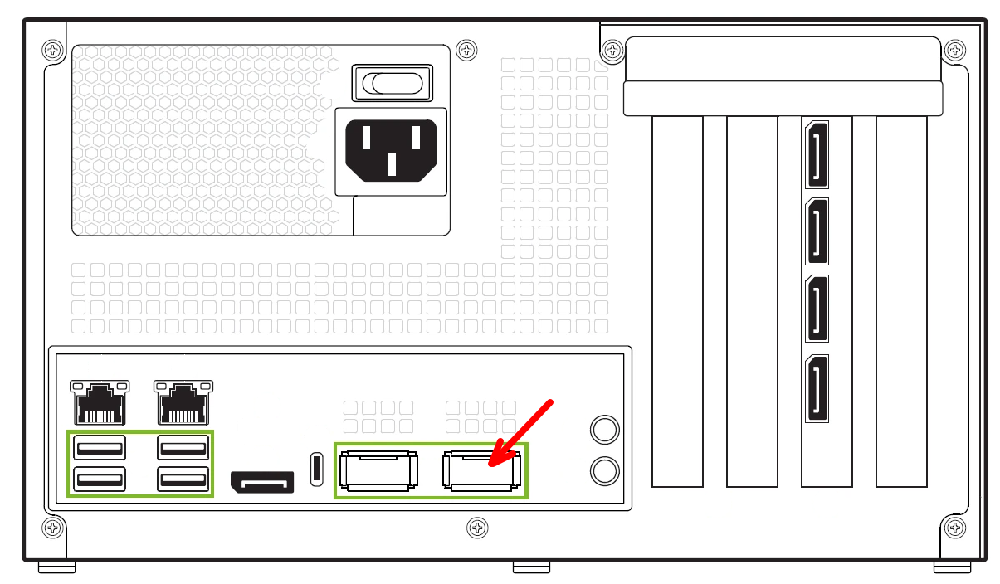
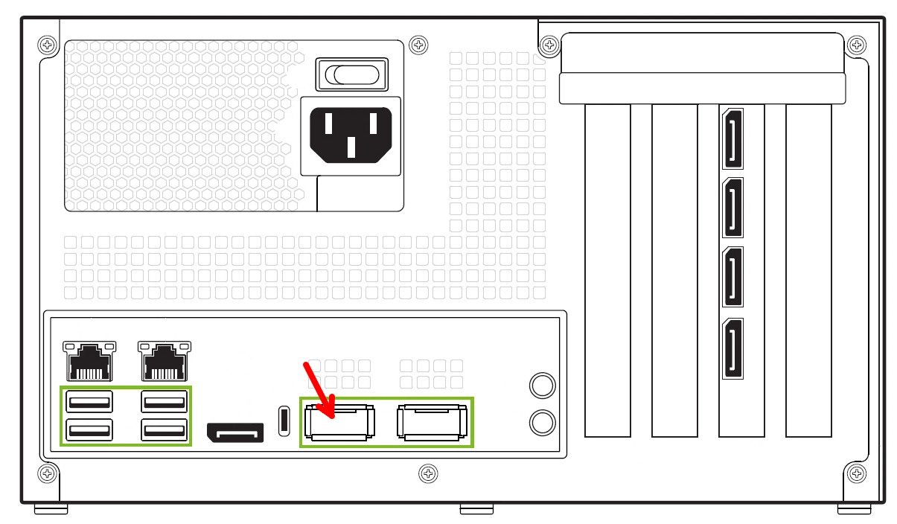
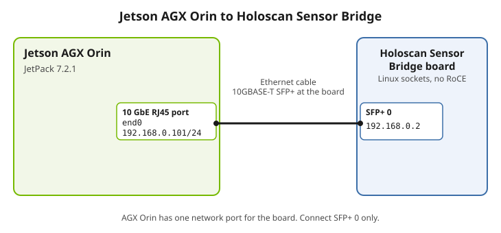
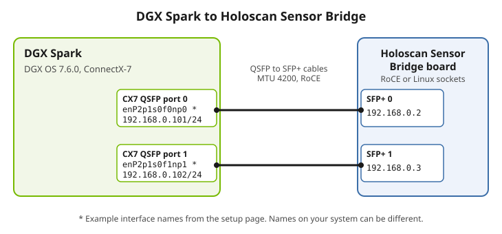
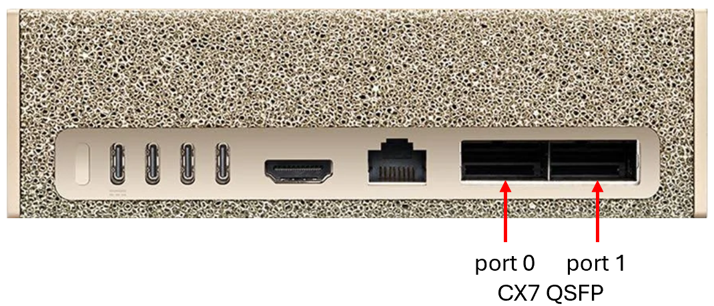
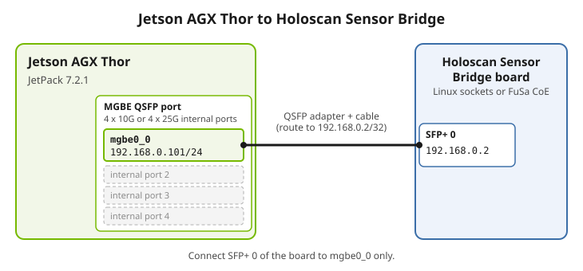

<Anchor id="HostSetupTarget" />

Holoscan Sensor Bridge 3.0 uses Holoscan SDK 5.0 and CUDA 13. Holoscan Sensor Bridge 3.0
supports these configurations:

- IGX Thor Developer Kit (T7000) systems configured with
  [IGX SW 2.0.1](https://developer.nvidia.com/igx-downloads) with CX7 SmartNIC devices.
  Two graphics configurations are supported: Thor integrated GPU (iGPU) graphics and
  discrete GPU (dGPU) graphics using an optional RTX PRO 6000 series dGPU, for example
  the NVIDIA RTX PRO 6000 Blackwell Max-Q Workstation Edition. Holoscan SDK 5 does not
  support IGX Orin (IGX OS 1.x).
- AGX Orin systems running
  [JetPack 7.2.1](https://developer.nvidia.com/embedded/jetpack). In this configuration,
  the on-board Ethernet controller is used with the Linux kernel network stack for data
  I/O; all network I/O is performed by the CPU without network acceleration.
- AGX Thor systems running
  [JetPack 7.2.1](https://developer.nvidia.com/embedded/jetpack) with MGBE SmartNIC
  device and Camera-over-Ethernet (CoE) transport.
- DGX Spark systems running
  [DGX OS 7.6.0](https://docs.nvidia.com/dgx/dgx-os-7-user-guide/introduction.html) with
  CX7 SmartNIC devices.
- x86 Linux workstations with an NVIDIA discrete GPU. Two host receive paths are
  supported: unaccelerated Linux socket-based receivers (used primarily for development
  or testing purposes) and an accelerated RoCE path that requires a ConnectX network
  adapter on the link to the sensor bridge. Note that this configuration is not part of
  the primary reference platforms; GPUDirect RDMA into GPU memory on the RoCE path may
  appear available from the GPU and driver even when the PCIe path on the host does not
  support it, in which case you must disable GPU VRAM frame buffers at build time (see
  the **x86 Linux** tab).

**Holoscan SDK 5 does not support IGX Orin (IGX OS 1.x) or JetPack 6. For these
platforms, use
[Holoscan Sensor Bridge 2.7](https://github.com/nvidia-holoscan/holoscan-sensor-bridge/tree/2.7.0).**

After the [Holoscan sensor bridge board is set up](sensor_bridge_hardware_setup.mdx),
configure a few prerequisites in your host system. While holoscan sensor bridge
demonstration applications usually run in a container, these commands are all to be
executed outside the container, on the host system directly. These configurations are
remembered across power cycles and therefore only need to be set up once.

- Install [git-lfs](https://git-lfs.com)

  Some data files in the Holoscan sensor bridge source repository use GIT LFS.

  ```none
  sudo apt-get update
  sudo apt-get install -y git-lfs
  ```

- Grant your user permission to the docker subsystem:

  ```none
  sudo usermod -aG docker $USER
  ```

  Reboot the computer to activate this setting.

Next, follow the directions on the appropriate tab below to configure your host system.

<Tabs>

<Tab title="IGX">

These steps are for the IGX Thor Developer Kit (T7000) with IGX SW 2.0.1. IGX Thor T7000
has a Thor iGPU and a ConnectX-7 (CX7) SmartNIC. One configuration also has an RTX PRO
6000 dGPU.



- If your IGX Thor T7000 has an RTX PRO 6000 dGPU, select the GPU that runs the
  applications. `CUDA_VISIBLE_DEVICES` selects one of the two GPUs:

  - `CUDA_VISIBLE_DEVICES=0` selects the dGPU.
  - `CUDA_VISIBLE_DEVICES=1` selects the Thor iGPU.

  Do not set `CUDA_VISIBLE_DEVICES=0,1`.

  The visualizer (HoloViz) must use the GPU that drives the display. If the application
  GPU and the display GPU are not the same, the visualizer fails with the message
  `No suitable adapter found for surface`. In this case, do one of these steps:

  - Run the application with `--headless`. With this option, the C++ and Python examples
    render into a GPU image and do not open a window. These examples have no
    `--headless` option: `imx274_module_tutorial.cpp`, `imx274_module_tutorial.py`,
    `linux_sub_frame_imx274_hsdk5_player.cpp` and `sub_frame_vb1940_player.cpp`. Run
    `signal_generator.cpp` and `signal_generator.py` with `--no-gui`.
  - Move the graphics output to the GPU that runs the applications. Default
    configurations of IGX Thor T7000 use iGPU graphics. To reconfigure the device for
    dGPU graphics, follow the IGX Thor platform instructions
    [here](https://docs.nvidia.com/igx/user-guide/latest/SW/gpu/dgpu-support.html#enabling-dgpu-display-and-graphics).

- Determine the name of the network device associated with the first CX7 port. This is
  the rightmost QSFP port when looking at the back of the IGX unit.



```none
  ls /sys/class/infiniband
```

```none
  roceP4p3s0f0 roceP4p3s0f1
```

This will produce a list of CX7 ports; your device names may vary. The lowest numbered
one, in this case `roceP4p3s0f0`, is the first CX7 port.

Assign the name of the first CX7 port to the variable `$IN0`.

```none
  LC_COLLATE=C IN=(/sys/class/infiniband/*)
  IN0=`basename ${IN[0]}`
  echo $IN0
```

```none
  roceP4p3s0f0
```

Next, determine which host ethernet port is associated with that device, and assign that
to the variable `$EN0`, which we'll use later during network configuration.

```none
  EN0=`basename /sys/class/infiniband/$IN0/device/net/*`
  echo $EN0
```

```none
  enP4p3s0f0np0
```

In summary, the host network interface associated with `$IN0` (`roceP4p3s0f0`) is `$EN0`
(`enP4p3s0f0np0`); your specific device names may vary.

- IGX SW uses NetworkManager to configure network interfaces. By default, the sensor
  bridge device uses the address 192.168.0.2 for the first port. Set up your first
  ethernet device (`$EN0`) to use the address 192.168.0.101 with a permanent route to
  192.168.0.2 using the
  [recommended MTU](https://enterprise-support.nvidia.com/s/article/mtu-considerations-for-roce-based-applications)
  for use with RoCE: ([Here](notes.mdx#holoscan-sensor-bridge-ip-address-configuration)
  is more information about configuring your system if you cannot use the 192.168.0.0/24
  network in this way.)

```none
  sudo nmcli con add con-name hololink-$EN0 ifname $EN0 type ethernet ip4 192.168.0.101/24
  sudo nmcli connection modify hololink-$EN0 +ipv4.routes 192.168.0.2/32
  sudo nmcli connection modify hololink-$EN0 ethtool.ring-rx 4096
  sudo nmcli connection modify hololink-$EN0 802-3-ethernet.mtu 4200
  sudo nmcli connection up hololink-$EN0
```

Apply power to the sensor bridge device, ensure that it's properly connected, then
`ping 192.168.0.2` to check connectivity:

```none
  ping 192.168.0.2
  PING 192.168.0.2 (192.168.0.2) 56(84) bytes of data.
  64 bytes from 192.168.0.2: icmp_seq=1 ttl=64 time=0.225 ms
  64 bytes from 192.168.0.2: icmp_seq=2 ttl=64 time=0.081 ms
  64 bytes from 192.168.0.2: icmp_seq=3 ttl=64 time=0.088 ms
  64 bytes from 192.168.0.2: icmp_seq=4 ttl=64 time=0.132 ms
  ^C
  --- 192.168.0.2 ping statistics ---
  4 packets transmitted, 4 received, 0% packet loss, time 3057ms
  rtt min/avg/max/mdev = 0.081/0.131/0.225/0.057 ms
```

- The second SFP+ connector on the sensor bridge device is used to transmit data
  acquired from the second camera on a stereo camera module (like the IMX274). By
  default, the sensor bridge device uses the address 192.168.0.3 for that second port.
  Connect the second IGX QSFP port (indicated with the red arrow below) to the second
  SFP+ port on the sensor bridge device.



Let's refer to these as `$IN1` and `$EN1`. Given the commands to assign `$IN0` and
`$EN0` above,

```none
  IN1=`basename ${IN[1]}`
  echo $IN1
  EN1=`basename /sys/class/infiniband/$IN1/device/net/*`
  echo $EN1
```

```none
  roceP4p3s0f1
  enP4p3s0f1np1
```

As above, your device names may be different. Configure the second QSFP network port
with an appropriate address and permanent route:

```none
  sudo nmcli con add con-name hololink-$EN1 ifname $EN1 type ethernet ip4 192.168.0.102/24
  sudo nmcli connection modify hololink-$EN1 +ipv4.routes 192.168.0.3/32
  sudo nmcli connection modify hololink-$EN1 ethtool.ring-rx 4096
  sudo nmcli connection modify hololink-$EN1 802-3-ethernet.mtu 4200
  sudo nmcli connection up hololink-$EN1
```

Now test the second connection with `ping 192.168.0.3`:

```none
  ping 192.168.0.3
  PING 192.168.0.3 (192.168.0.3) 56(84) bytes of data.
  64 bytes from 192.168.0.3: icmp_seq=1 ttl=64 time=0.210 ms
  64 bytes from 192.168.0.3: icmp_seq=2 ttl=64 time=0.271 ms
  64 bytes from 192.168.0.3: icmp_seq=3 ttl=64 time=0.181 ms
  64 bytes from 192.168.0.3: icmp_seq=4 ttl=64 time=0.310 ms
  64 bytes from 192.168.0.3: icmp_seq=5 ttl=64 time=0.258 ms
  ^C
  --- 192.168.0.3 ping statistics ---
  5 packets transmitted, 5 received, 0% packet loss, time 4102ms
  rtt min/avg/max/mdev = 0.181/0.246/0.310/0.045 ms
```

When the second port is configured, the first port should continue to respond to pings
as appropriate.

</Tab>
<Tab title="AGX Orin">



- Install JetPack 7.2.1 with [SDK Manager](https://developer.nvidia.com/sdk-manager). To
  build and run the examples, make sure you install the CUDA Toolkit in the Jetson SDK
  Components.

Demos and examples in this package assume a sensor bridge device is connected to `end0`,
which is the RJ45 connector on the AGX Orin.

- Configure a static IP address of 192.168.0.101 on the on-board network port.

L4T uses NetworkManager to configure interfaces; by default interfaces are configured as
DHCP clients. Use the following command to update the IP address to 192.168.0.101.
([Here](notes.mdx#holoscan-sensor-bridge-ip-address-configuration) is more information
about configuring your system if you cannot use the 192.168.0.0/24 network in this way.)

On AGX Orin with JetPack 7.2.1, the on-board Ethernet device is `end0`. If your
configuration is different, use the applicable name for the variable EN0:

```none
  EN0=end0
  sudo nmcli con add con-name hololink-$EN0 ifname $EN0 type ethernet ip4 192.168.0.101/24
  sudo nmcli connection up hololink-$EN0
```

Apply power to the sensor bridge device, ensure that it's properly connected, then
`ping 192.168.0.2` to check connectivity.

- For the Linux socket-based examples, isolating a processor core from Linux kernel is
  recommended. For high bandwidth applications, like 4k video acquisition, isolation of
  the network receiver core is required. When an example program runs with processor
  affinity set to that isolated core, performance is improved and latency is reduced. By
  default, sensor bridge software runs the time-critical background network receiver
  process on the third processor core. If that core is isolated from Linux scheduling,
  no processes will be scheduled on that core without an explicit request from the user,
  and reliability and performance is greatly improved.

Isolating that core from Linux can be achieved by editing
`/boot/extlinux/extlinux.conf`. Add the setting `isolcpus=2` to the end of the line that
starts with `APPEND`. Your file should look like something like this:

```none
  TIMEOUT 30
  DEFAULT primary
   
  MENU TITLE L4T boot options
   
  LABEL primary
        MENU LABEL primary kernel
        LINUX /boot/Image
        ...
        APPEND ${cbootargs} ...<other-settings>... isolcpus=2
```

Sensor bridge applications can run the network receiver process on another core by
setting the environment variable `HOLOLINK_AFFINITY` to the core it should run on. For
example, to run on the first processor core,

```none
  HOLOLINK_AFFINITY=0 python3 examples/linux_imx274_player.py
```

If `HOLOLINK_AFFINITY` is blank or not set, the network receiver runs on the third
processor core (core 2).

- Run the "jetson_clocks" tool on startup, to set the core clocks to their maximum.

```none
JETSON_CLOCKS_SERVICE=/etc/systemd/system/jetson_clocks.service
cat <<EOF | sudo tee $JETSON_CLOCKS_SERVICE >/dev/null
[Unit]
Description=Jetson Clocks Startup
After=nvpmodel.service
   
[Service]
Type=oneshot
ExecStart=/usr/bin/jetson_clocks
   
[Install]
WantedBy=multi-user.target
EOF

sudo chmod u+x $JETSON_CLOCKS_SERVICE
sudo systemctl enable jetson_clocks.service
```

- Set the AGX Orin power mode to 'MAXN' for optimal performance. The setting can be
  changed via L4T power drop down setting found on the upper left corner of the screen:


- Restart the AGX Orin. This allows core isolation and performance settings to take
  effect. If configuring for 'MAXN' performance doesn't request that you reset the unit,
  then execute the reboot command manually:

```none
  reboot
```

When the system comes back up, build Holoscan Sensor Bridge outside the container with
the [native build steps](build.mdx#NativeBuildTarget) on the Build page. A full JetPack
7.2.1 installation does not leave enough disk space for the container build.

</Tab>
<Tab title="DGX Spark">



- Install DGX OS 7.6.0. NVIDIA tested Holoscan Sensor Bridge 3.0 with this DGX OS
  version.

- First check for the OTA ConnectX-7 hotplug feature and disable + reboot if present.
  This disables the NIC if no link is detected which can interfere with these
  instructions and HSB operation. Note that if your NIC powers down without anything
  attached, but the file below is not present, you may not have the ability to disable
  and should update OTA.

```
  if [ -f /etc/nvidia/cx7-hotplug-enabled ] ; then
      sudo mv /etc/nvidia/cx7-hotplug-enabled /etc/nvidia/cx7-hotplug-disabled
      sudo reboot
  fi
```

- Determine the name of the network device associated with the first CX7 port. This is
  the leftmost QSFP port when looking at the back of the DGX Spark unit ("port 0" in the
  image below). Note the specific device names `echo`'d below may be different or change
  depending on the specific system's driver configuration.



```none
  ls /sys/class/infiniband
```

```none
  roceP2p1s0f0  roceP2p1s0f1  rocep1s0f0  rocep1s0f1
```

This will produce a list of infiniband devices connected to the CX7 ports; your device
names may vary. The lowest numbered one, in this case `roceP2p1s0f0`, is the first CX7
port. Let's assign that name to the variable `$IN0`.

```none
  LC_COLLATE=C IN=(/sys/class/infiniband/*)
  IN0=`basename ${IN[0]}`
  echo $IN0
```

```none
  roceP2p1s0f0
```

Next, determine which host ethernet port is associated with that device, and assign that
to the variable `$EN0`, which we'll use later during network configuration.

```none
  EN0=`basename /sys/class/infiniband/$IN0/device/net/*`
  echo $EN0
```

```none
  enP2p1s0f0np0
```

In summary, the host network interface associated with `$IN0` (`roceP2p1s0f0`) is `$EN0`
(`enP2p1s0f0np0`); your specific device names may vary.

- DGX OS uses NetworkManager to configure network interfaces. By default, the sensor
  bridge device uses the address 192.168.0.2 for the first port. Set up your first
  ethernet device (`$EN0`) to use the address 192.168.0.101 with a permanent route to
  192.168.0.2 using the
  [recommended MTU](https://enterprise-support.nvidia.com/s/article/mtu-considerations-for-roce-based-applications)
  for use with RoCE: ([Here](notes.mdx#holoscan-sensor-bridge-ip-address-configuration)
  is more information about configuring your system if you cannot use the 192.168.0.0/24
  network in this way.)

```none
  sudo nmcli con add con-name hololink-$EN0 ifname $EN0 type ethernet ip4 192.168.0.101/24
  sudo nmcli connection modify hololink-$EN0 +ipv4.routes 192.168.0.2/32
  sudo nmcli connection modify hololink-$EN0 ethtool.ring-rx 4096
  sudo nmcli connection modify hololink-$EN0 802-3-ethernet.mtu 4200
  sudo nmcli connection up hololink-$EN0
```

Apply power to the sensor bridge device, ensure that it's properly connected, then
`ping 192.168.0.2` to check connectivity:

```none
  ping 192.168.0.2
  PING 192.168.0.2 (192.168.0.2) 56(84) bytes of data.
  64 bytes from 192.168.0.2: icmp_seq=1 ttl=64 time=0.225 ms
  64 bytes from 192.168.0.2: icmp_seq=2 ttl=64 time=0.081 ms
  64 bytes from 192.168.0.2: icmp_seq=3 ttl=64 time=0.088 ms
  64 bytes from 192.168.0.2: icmp_seq=4 ttl=64 time=0.132 ms
  ^C
  --- 192.168.0.2 ping statistics ---
  4 packets transmitted, 4 received, 0% packet loss, time 3057ms
  rtt min/avg/max/mdev = 0.081/0.131/0.225/0.057 ms
```

- The second SFP+ connector on the sensor bridge device is used to transmit data
  acquired from the second camera on a stereo camera module (like the IMX274). By
  default, the sensor bridge device uses the address 192.168.0.3 for that second port.
  Connect the second DGX Spark QSFP port ("port 1" in the image above) to the second
  SFP+ port on the sensor bridge device.

Let's refer to these as `$IN1` and `$EN1`. Given the commands to assign `$IN0` and
`$EN0` above,

```none
  IN1=`basename ${IN[1]}`
  echo $IN1
  EN1=`basename /sys/class/infiniband/$IN1/device/net/*`
  echo $EN1
```

```none
  roceP2p1s0f1
  enP2p1s0f1np1
```

As above, your device names may be different. Configure the second QSFP network port
with an appropriate address and permanent route:

```none
  sudo nmcli con add con-name hololink-$EN1 ifname $EN1 type ethernet ip4 192.168.0.102/24
  sudo nmcli connection modify hololink-$EN1 +ipv4.routes 192.168.0.3/32
  sudo nmcli connection modify hololink-$EN1 ethtool.ring-rx 4096
  sudo nmcli connection modify hololink-$EN1 802-3-ethernet.mtu 4200
  sudo nmcli connection up hololink-$EN1
```

Now test the second connection with `ping 192.168.0.3`:

```none
  ping 192.168.0.3
  PING 192.168.0.3 (192.168.0.3) 56(84) bytes of data.
  64 bytes from 192.168.0.3: icmp_seq=1 ttl=64 time=0.210 ms
  64 bytes from 192.168.0.3: icmp_seq=2 ttl=64 time=0.271 ms
  64 bytes from 192.168.0.3: icmp_seq=3 ttl=64 time=0.181 ms
  64 bytes from 192.168.0.3: icmp_seq=4 ttl=64 time=0.310 ms
  64 bytes from 192.168.0.3: icmp_seq=5 ttl=64 time=0.258 ms
  ^C
  --- 192.168.0.3 ping statistics ---
  5 packets transmitted, 5 received, 0% packet loss, time 4102ms
  rtt min/avg/max/mdev = 0.181/0.246/0.310/0.045 ms
```

When the second port is configured, the first port should continue to respond to pings
as appropriate.

</Tab>
<Tab title="AGX Thor">



- After installing JetPack 7.2.1 on the AGX Thor developer kit, complete the following
  steps.

If installation was done using the ISO method, install
[CUDA Toolkit 13.2](https://developer.nvidia.com/cuda-downloads?target_os=Linux&target_arch=arm64-sbsa&Compilation=Native&Distribution=Ubuntu&target_version=24.04&target_type=deb_local)
and execute the following:

```none
  export PATH=/usr/local/cuda/bin:$PATH
  export LD_LIBRARY_PATH=/usr/local/cuda/lib64:$LD_LIBRARY_PATH
  wget https://developer.nvidia.com/downloads/embedded/L4T/r39_Release_v2.1/release/Jetson_SIPL_API_R39.2.1_aarch64.tbz2
  wget https://developer.nvidia.com/downloads/embedded/L4T/r39_Release_v2.1/release/Jetson_Multimedia_API_R39.2.1_aarch64.tbz2
  sudo tar xjf Jetson_SIPL_API_R39.2.1_aarch64.tbz2 -C /
  sudo tar xjf Jetson_Multimedia_API_R39.2.1_aarch64.tbz2 -C /
```

- For the Linux socket-based examples, isolating a processor core from Linux kernel is
  recommended. For high bandwidth applications, like 4k video acquisition, isolation of
  the network receiver core is required. When an example program runs with processor
  affinity set to that isolated core, performance is improved and latency is reduced. By
  default, sensor bridge software runs the time-critical background network receiver
  process on the third processor core. If that core is isolated from Linux scheduling,
  no processes will be scheduled on that core without an explicit request from the user,
  and reliability and performance is greatly improved.

Isolating that core from Linux can be achieved by editing
`/boot/extlinux/extlinux.conf`. Add the setting `isolcpus=2` to the end of the line that
starts with `APPEND`. Your file should look like something like this:

```none
  TIMEOUT 30
  DEFAULT primary
   
  MENU TITLE L4T boot options
   
  LABEL primary
        MENU LABEL primary kernel
        LINUX /boot/Image
        ...
        APPEND ${cbootargs} ...<other-settings>... isolcpus=2
```

Sensor bridge applications can run the network receiver process on another core by
setting the environment variable `HOLOLINK_AFFINITY` to the core it should run on. For
example, to run on the first processor core,

```none
  HOLOLINK_AFFINITY=0 python3 examples/linux_imx274_player.py
```

If `HOLOLINK_AFFINITY` is blank or not set, the network receiver runs on the third
processor core (core 2).

**This step requires a system reboot to take effect.**

- To build and run the C++ FuSa CoE examples outside the container, install the build
  dependencies. The dependencies are CMake 4, Holoscan SDK 5.0.0, nvCOMP 5.2.0 and Slang
  2026.14. The [native build steps](build.mdx#NativeBuildTarget) on the Build page show
  how. The [Holoscan Sensor Bridge container](build.mdx) includes these dependencies.

- Enable the network interface and ensure that the camera enumerates (assumes camera IP
  address 192.168.0.2):

```none
  EN0=mgbe0_0
  sudo nmcli con add con-name hololink-$EN0 ifname $EN0 type ethernet ip4 192.168.0.101/24
  sudo nmcli connection modify hololink-$EN0 +ipv4.routes 192.168.0.2/32
  sudo nmcli connection up hololink-$EN0
```

- Get and build Holoscan Sensor Bridge:

Holoscan Sensor Bridge 3.0 supports two ways to run the examples on AGX Thor. You can
run the C++ and Python examples outside the container, after the native build. You can
also run them in the Holoscan Sensor Bridge container.

To build outside the container, follow the
[native build steps](build.mdx#NativeBuildTarget) on the Build page. On AGX Thor, use
the CMake options `-DHOLOLINK_BUILD_ROCE=0 -DHOLOLINK_BUILD_FUSA=1`.

<b> Running the CoE-Accelerated Examples </b>

Thor's hardware-accelerated CoE capabilities can be leveraged by Holoscan Sensor Bridge
using one of two different paths outlined below.

<b> SIPL </b>

[SIPL](https://docs.nvidia.com/jetson/archives/r39.2/DeveloperGuide/SD/CameraDevelopment/SIPLFramework/Introduction-to-SIPL.html)
is a modular, extensible framework for image sensor control and image processing that
exposes the full hardware capabilities of Thor including CoE and ISP hardware
acceleration. SIPL-enabled sensor drivers are written using the
[Unified Device Driver Framework (UDDF)](uddf_drivers.mdx), and reference VB1940 UDDF
drivers are included with JetPack 7.2.

Holoscan Sensor Bridge does not include SIPL-based capture or SIPL example applications.
SIPL camera capture for Holoscan SDK 5 applications is provided by the `SIPLCaptureOp`
operator of the separate
[Holoscan Camera](https://github.com/nvidia-holoscan/holoscan-camera) module
(`holoscan_camera`); see the Holoscan Camera documentation for its build and run
instructions.

<b>FuSa</b>

FuSa is a new API included with JetPack 7.1+ which exposes access to Thor's CoE data
capture path without providing the additional camera control and ISP access that is
offered by SIPL. This allows applications direct control of the Holoscan Sensor Bridge
and attached sensors in a CoE-accelerated environment, bypassing the need for SIPL and
its UDDF driver implementations. This enables applications to follow a more traditional
Holoscan Sensor Bridge implementation where the sensor control is managed directly by
the application instead of by external drivers. Because of this, FuSa example
applications exist for the IMX274, VB1940, and TauroTech DA326 Hawk sensors using the
existing reference drivers provided by Holoscan Sensor Bridge.

A number of FuSa-based example applications are included for the IMX274, VB1940, and
TauroTech DA326 Hawk using the `fusa_coe_` prefix (Hawk variants:
`fusa_coe_max96716a_player`, `fusa_coe_hawk_single_link_player`,
`fusa_coe_hawk_dual_link_player`, `fusa_coe_single_network_stereo_hawk_player`). The C++
and Python sample applications can be run natively (not using a container) after the
[native build steps](build.mdx#NativeBuildTarget) on the Build page, or in the
[Holoscan Sensor Bridge container](build.mdx).

**NOTE:** The `python/setup.py` will by default not enable the necessary FuSa components
unless it detects the required /dev/coe\* devices or the `COE_OFFLOAD` environment
variable is set. No action is required in the provided docker container or in native
python binding builds on supported platforms.

To run the C++ VB1940 player example, go to the repository directory. Then run this
command. Use the IP address of your device:

```none
  sudo ./build/examples/fusa_coe_vb1940_player --hololink 192.168.0.2
```

<Warning>
On AGX Thor with JetPack 7.2.1, a FuSa CoE (`fusa_coe_`) application leaves an
interrupt active on `mgbe0_0` after it closes. Linux socket (`linux_`) applications on
that port can then lose packets. When the FuSa CoE application stops normally, it moves
this interrupt to a different CPU. Then the problem does not occur. This step needs root
privileges. The demo container has root privileges. Outside the container, run the
FuSa CoE application with `sudo`. Reboot before you run Linux socket applications on
that port in these cases:

- You killed the FuSa CoE application.
- The application logged a message that tells you to reboot before you run Linux-socket
  applications on this interface.

For more information, see [troubleshooting](troubleshooting.mdx).

</Warning>

- Building and running Li VB1940, IMX274, and TauroTech DA326 Hawk python examples from
  within the holoscan sensor bridge container is explained in the following pages of the
  user guide.

</Tab>
<Tab title="x86 Linux">

Use this tab when the host is an x86 PC running Linux with an NVIDIA discrete GPU.

**Capture paths on x86**

- **Socket-based receiver** — The standard Linux network stack path used by examples
  whose names are prefixed with `linux_` (for example `linux_imx274_player`). This does
  not require a ConnectX adapter; use whichever Ethernet interface reaches the sensor
  bridge and follow the same IP and [PTP](ptp.mdx) guidance as for other hosts. Note
  that this path is not accelerated, and so is often unable to keep up with the data
  rates required to stream typical sensor (e.g. camera) data, leading to intermittent
  data loss. This path is primarily meant for development purposes.

- **RoCE-accelerated receiver** — Uses RDMA over Converged Ethernet to the sensor bridge
  and requires a Mellanox/NVIDIA ConnectX adapter on that link. The interface setup
  requirements (i.e. addresses, routes, ring buffers, MTU) match IGX or DGX Spark: the
  sensor bridge must be reachable at its assigned address (e.g. `192.168.0.2`) using the
  same scheme as in the **IGX** or **DGX Spark** tabs above (adapt device names such as
  `$IN0`, `$EN0` to your system).

<Anchor id="gpudirect-rdma-on-the-roce-path" />

**GPUDirect RDMA on the RoCE path**

Using RoCE with GPUDirect RDMA into GPU memory requires the following:

- A workstation-class NVIDIA GPU (consumer and mobile GPUs do not support GPUDirect
  RDMA).
- The NVIDIA open kernel driver packages on the host (e.g. `nvidia-driver-open`).
- A PCIe topology where the ConnectX NIC and the GPU are peers such that the NIC can
  perform RDMA directly to the GPU (platform firmware, root-port layout, and IOMMU
  settings must allow this end-to-end).

When these requirements are met, frame buffers can reside in GPU memory and data
received from the sensor bridge can be written via RDMA directly to GPU memory. When the
GPU and driver support GPUDirect registration but the host PCIe system path does not
actually deliver RDMA writes into that memory, data received from the sensor bridge will
not actually be written to the GPU memory and will typically result in incorrect data
(e.g. black/blank image frames) and/or metadata mismatch errors. If this is the case,
the build must be configured to force the use of pinned host memory instead (see next
section).

**Demo container on x86**

Install Docker, Docker Buildx, and the
[NVIDIA Container Toolkit](https://docs.nvidia.com/datacenter/cloud-native/container-toolkit/latest/install-guide.html)
on the host. Build the demo image (see [build instructions](build.mdx)):

```none
  sh docker/build.sh
```

**When GPUDirect RDMA does not work end-to-end**

It may be the case that RoCE RDMA looks healthy while RDMA writes into registered GPU
memory do not actually succeed; for example, when the GPU supports GPUDirect but the
PCIe configuration does not allow the ConnectX NIC to reach the GPU as an RDMA peer.
Symptoms include a black or blank image and application log lines similar to:

```none
  ERROR 6.6634 roce_receiver.cpp:826 get_next_frame tid=0x61 -- Metadata psn=0 but received_psn=483318.
```

This is a strong indication to rebuild with GPU VRAM disabled so the RoCE receiver uses
pinned host memory instead:

- **Demo container:** pass `--disable-roce-gpu-vram` to `docker/build.sh` to build the
  image. Example:

```none
  sh docker/build.sh --disable-roce-gpu-vram
```

- **Native CMake build:** configure with:

```none
  -DHOLOLINK_ROCE_USE_GPU_VRAM=OFF
```

Using pinned host memory instead of GPU VRAM enables a partly accelerated path: the NIC
will still RDMA directly to the system memory using RoCE, bypassing the Linux networking
subsystem, but this data will then need to be transferred across PCIe when the GPU later
reads the data.

When the [GPUDirect RDMA requirements](#gpudirect-rdma-on-the-roce-path) are satisfied
on your machine, the default build keeps `HOLOLINK_ROCE_USE_GPU_VRAM` on and the fully
accelerated GPUDirect RDMA path can be used. Internally, this path has been validated on
an AMD Threadripper-based Lenovo ThinkStation workstation with a ConnectX-6 Dx network
adapter and Quadro RTX 6000 GPU.

</Tab>
</Tabs>

Now, for all configurations,

- Configure the network receiver buffer for running unaccelerated network examples:
  Holoscan sensor bridge supports running Li VB1940, IMX274, and TauroTech DA326 Hawk
  using unaccelerated network Linux sockets. For best performance of these examples
  increase the Linux sockets network receiver buffer:

  ```none
  echo 'net.core.rmem_max = 31326208' | sudo tee /etc/sysctl.d/52-hololink-rmem_max.conf
  sudo sysctl -p /etc/sysctl.d/52-hololink-rmem_max.conf
  ```

- Make sure that $EN0 is set to the name of the Ethernet controller connected to HSB.
  Some installations require reboots which will clear this value, so be sure and
  configure it appropriately for your configuration per the instructions above.

- Enable PTP on $EN0. This synchronizes the timestamps reported with received data with
  the host time.

  Run the `phc2sys` tool at boot time. This synchronizes the clock in $EN0 with the
  system clock. First, install the `linuxptp` tool.

  ```none
  sudo apt update && sudo apt install -y linuxptp
  ```

  Next, set up a systemd service file that will run `phc2sys`. The `Restart=` settings
  matter: `phc2sys` holds an open handle to the NIC's PTP hardware clock, and whenever
  the NIC is reset (for example when the CoE capture driver recovers `$EN0` after a
  `ptp4l` fault) that clock is re-registered under a new `/dev/ptpN` and `phc2sys` exits
  with `ioctl PTP_SYS_OFFSET: No such device`. Without a restart policy the NIC clock
  then free-runs until someone notices.

  ```none
  PHC2SYS_SERVICE=/etc/systemd/system/phc2sys-$EN0.service
  cat <<EOF | sudo tee $PHC2SYS_SERVICE >/dev/null
  [Unit]
  Description=Copy system time to $EN0
  Requires=NetworkManager.service
  After=NetworkManager.service
  After=timemaster.service
  # Never give up restarting; the default 5-starts-per-10-s limit would leave the
  # clock unsynchronized after a burst of NIC resets.
  StartLimitIntervalSec=0

  [Service]
  Type=simple
  ExecStartPre=timeout 3m bash -c "until [ \"\$(nmcli -g GENERAL.STATE device show $EN0)\" = \"100 (connected)\" ]; do sleep 1; done"
  ExecStart=/usr/sbin/phc2sys -c $EN0 -s CLOCK_REALTIME -O 0 -S 0.0001
  # Restart when phc2sys exits on its own (NIC reset, PTP clock re-registered); wait
  # long enough for the interface to come back before the ExecStartPre check runs.
  Restart=on-failure
  RestartSec=5

  [Install]
  WantedBy=multi-user.target
  EOF
  ```

  Note that each restart steps the NIC clock onto system time again, so expect one PTP
  step on the HSB after every NIC reset.

  Configure it for execution at startup, and start it now.

  ```none
  sudo chmod u+x $PHC2SYS_SERVICE
  sudo systemctl enable phc2sys-$EN0.service
  sudo systemctl start phc2sys-$EN0.service
  ```

Next, run `ptp4l` to send PTP SYNC messages to $EN0.

The host is the only PTP clock on this link, so `ptp4l` is configured as a dedicated
time source (`serverOnly 1`) with the Best Master Clock Algorithm switched off
(`BMCA noop`). This matters because HSB applications reset the FPGA when they start,
which drops the Ethernet link for a moment. With the default algorithm `ptp4l` reacts to
every link flap by going FAULTY, then LISTENING, and only becomes MASTER again after the
announce-receipt timeout, three announce intervals of 2 s plus a random 0 to 2 s. For
those 6 to 8 s no SYNC messages are sent, the HSB cannot lock, and an application that
waits for PTP lock before streaming (for example the stereo VSYNC path) is stalled for
that long on every start. With the designated-master state machine selected by these two
options the port goes straight from FAULTY to MASTER when the link comes back, and SYNC
resumes within the next sync interval. `ptp4l` requires one of `serverOnly` or
`clientOnly` whenever `BMCA` is `noop`; with `serverOnly` the port will never follow
another master, which is the intended behaviour here.

The last two settings keep a transmit-timestamp fault from taking the master away for
long. Some NICs occasionally take more than the default 10 ms to return the hardware
transmit timestamp of a SYNC message; `ptp4l` then logs
`timed out while polling for tx timestamp` and `send sync failed`, puts the port in
FAULTY, and with the default `fault_reset_interval` of 4 (the value is log2 seconds)
sends nothing for 16 s. While the master is silent the HSB keeps its clock running at
the last correction it computed, and when SYNC returns the HSB steps its clock back onto
host time; after 16 s that step can be large enough to disturb a running synchronized
camera pair. `tx_timestamp_timeout 50` gives the NIC 50 ms for the timestamp so the
fault becomes rare, and `fault_reset_interval 0` re-initializes the port after about one
second, so a fault that still happens costs about one second of SYNC instead of 16.

```none
cat <<EOF | sudo tee /etc/linuxptp/hsb-ptp.conf >/dev/null
# This configuration is appropriate for NVIDIA Holoscan sensor bridge
# applications, where PTP messages are sent over L2 and a 1/2 second interval.
# The host is the only time source on the link: run as a dedicated master and skip
# the BMCA election, so SYNC resumes right after a link flap (HSB reset) instead
# of after the 6-8 s announce-receipt timeout.
# Allow 50 ms for the NIC to return a SYNC transmit timestamp, and re-initialize the
# port about one second (2^0 s) after a fault instead of the default 16 s, so the HSB
# is not left on its own clock for long.
[global]
logSyncInterval -1
logMinDelayReqInterval -1
network_transport L2
serverOnly 1
BMCA noop
tx_timestamp_timeout 50
fault_reset_interval 0
EOF
```

Set up a systemd service file for this.

```none
PTP4L_SERVICE=/etc/systemd/system/ptp4l-$EN0.service
cat <<EOF | sudo tee $PTP4L_SERVICE >/dev/null
[Unit]
Description=Send PTP SYNC messages to $EN0
After=phc2sys-$EN0.service
 
[Service]
Type=simple
ExecStart=/usr/sbin/ptp4l -i $EN0 -f /etc/linuxptp/hsb-ptp.conf
 
[Install]
WantedBy=multi-user.target
EOF
```

Finally, run it.

```none
sudo chmod u+x $PTP4L_SERVICE
sudo systemctl enable ptp4l-$EN0.service
sudo systemctl start ptp4l-$EN0.service
```

If `hsb-ptp.conf` changed on a host where `ptp4l` is already running, restart the
service so the new configuration is picked up. Do this while no HSB application is
streaming, because the HSB re-synchronizes to the master when it comes back.

```none
sudo systemctl restart ptp4l-$EN0.service
```

To confirm the configuration is active, start an HSB application (or bounce the link)
and look at the service journal:

```none
journalctl -u ptp4l-$EN0.service -f
```

After the link flap the port must log `FAULTY to MASTER on INIT_COMPLETE`. Seeing
`FAULTY to LISTENING on INIT_COMPLETE` followed several seconds later by
`LISTENING to MASTER on ANNOUNCE_RECEIPT_TIMEOUT_EXPIRES` means the default election is
still in use and `serverOnly 1` / `BMCA noop` are not in the configuration file the
service loads (check the `-f` path in `ExecStart`). If a
`timed out while polling for tx timestamp` fault does occur, the following
`FAULTY to MASTER on INIT_COMPLETE` must appear about one second later; a 16 s gap means
`fault_reset_interval 0` is not in effect.

- Optional: log in to NVIDIA GPU Cloud (NGC) with your developer account. The container
  base image (`nvcr.io/nvidia/cuda:13.0.0-runtime-ubuntu24.04`) is public. Thus you do
  not have to log in to build the Holoscan Sensor Bridge container. Log in if you use
  other NGC resources.

  - If you don't have a developer account for NGC please register at
    [https://catalog.ngc.nvidia.com/](https://catalog.ngc.nvidia.com/)

  - Create an API key for your account:
    [https://ngc.nvidia.com/setup/api-key](https://ngc.nvidia.com/setup/api-key)

  - Use your API key to log in to nvcr.io:

  ```none
    docker login nvcr.io
    Username: $oauthtoken
    Password: <Your token key to NGC>
    WARNING! Your password will be stored unencrypted in /home/<user>/.docker/config.json.
    Configure a credential helper to remove this warning. See
    https://docs.docker.com/engine/reference/commandline/login/#credentials-store

    Login Succeeded
  ```

Now proceed to [Build](build.mdx) to build the Holoscan Sensor Bridge software, in the
demo container or on the host.
