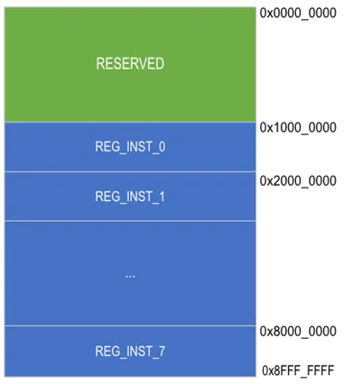
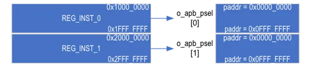
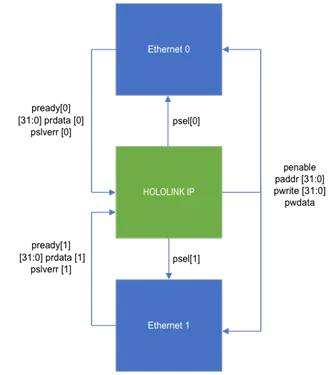

Advanced Peripheral Bus (APB) interface is used in the Holoscan Sensor Bridge IP for
internal register table read and write transactions. ECB commands from the host to
access registers are converted to APB within the Holoscan Sensor Bridge IP.

APB is an AMBA defined low complexity bus protocol with a fixed data and address bus
width of 32 bits. APB3 specification documented in version IHI0024E is used in the
Holoscan Sensor Bridge IP.

The register map of Holoscan Sensor Bridge IP is depicted below.

Figure 1. Register Map

## User Registers

The User register block maps from address 0x1000_0000 to 0x8FFF_FFFF and is subdivided
into number of blocks defined by REG_INST macro, with each subblock spanning
0x1000_0000.

The APB ports available on the Holoscan Sensor Bridge IP allow user to connect to user
specific blocks, for example, Ethernet MAC/PCS IP block or sensor interface registers,
where the Holoscan Sensor Bridge IP is the APB Requester.

The msb\[31:28] of the register address is used to determine the REG_INST\_# block and
the address \[27:0] is the offset address.

For example, if the host accesses register in 0x1000_0000 – 0x1FFF_FFFF address mapping,
this will trigger o_apb_psel\[0] with the offset address o_apb_paddr mapping 0x0000_0000
– 0x0FFF_FFFF and so on.

Figure 2. Register Instance Offset

Tie off unused REG_INST APB, pready, prdata, and pslverr signals to 0.

Holoscan Sensor Bridge IP APB bus supports 4-byte read and 4-byte writes. If less than
4-byte read and writes are desired, the user can implement byte-masking logic.

If no response is received from the APB Completer within 256 clock cycles, the APB bus
will timeout. If timeout is reached, the Holoscan Sensor Bridge IP will respond with an
invalid address response on the ECB.

Below is an example connection diagram to connect to 2 Ethernet IPs to the User Register
blocks respectively.

Figure 3. User Register Sub-Block
